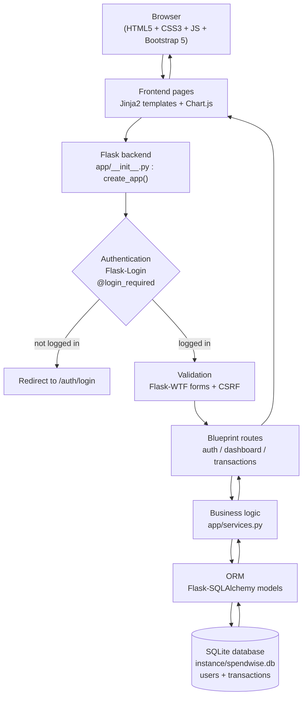
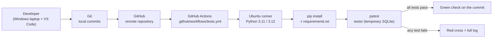
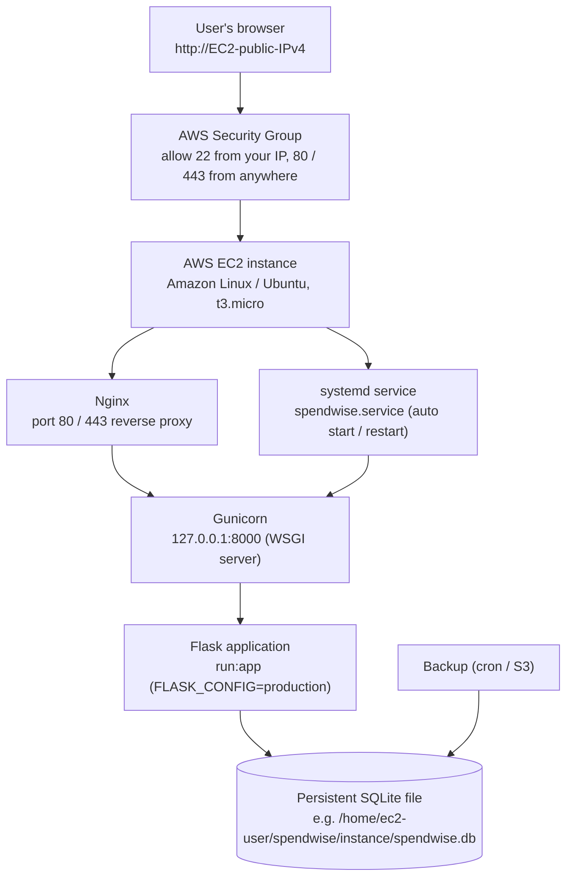
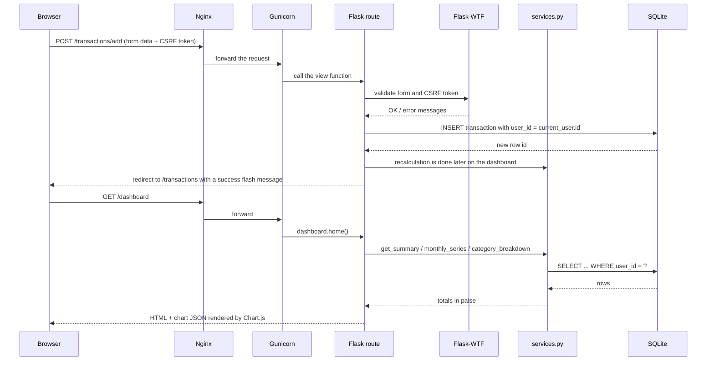
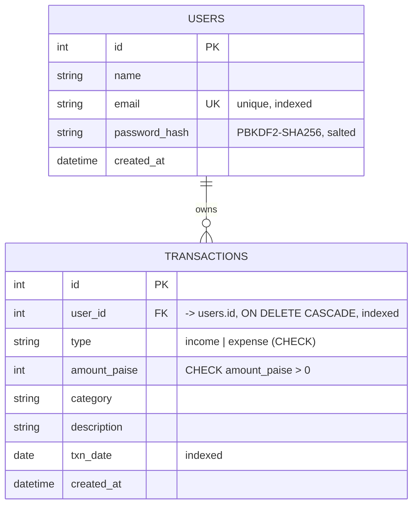

# SpendWise — Architecture

This document explains how SpendWise is put together, using three views:

1. **Application flow** — what happens when a user opens a page
2. **DevOps flow** — how the code travels from your laptop to GitHub and gets tested
3. **Cloud deployment** — how the same code runs on Amazon EC2

Every diagram uses [Mermaid](https://mermaid.js.org/) and is followed by a simple Hindi
explanation. Technical terms, file names and code stay in English.

---

## 1. Application flow

### Hindi explanation

| Component | Role (Hindi) |
| --- | --- |
| **Browser** | User ka phone ya laptop ka browser. Yahi se website khulti hai. |
| **Frontend** | HTML, CSS, Bootstrap aur JavaScript se bane pages. Chart.js graphs banata hai. Ye sirf dikhane ka kaam karta hai. |
| **Flask backend** | Asli dimaag. `create_app()` sab kuch taiyaar karta hai — database connection, login system, routes aur error pages. |
| **Authentication** | Flask-Login check karta hai ki user login hai ya nahi. Private page kholne se pehle `@login_required` rok deta hai aur login page par bhej deta hai. |
| **Validation** | Flask-WTF form ke saare fields check karta hai — amount, date, category, type. CSRF token se fake form submit nahi ho sakta. |
| **Blueprints** | Code ko teen hisson me baanta gaya hai — `auth` (login/register), `dashboard` (summary + charts), `transactions` (income/expense ka CRUD). |
| **Business logic** | `app/services.py` me saare jod-ghata (total income, total expense, balance, monthly series, category breakdown) hote hain — hamesha logged-in user ke hi records par. |
| **ORM** | Flask-SQLAlchemy Python code ko SQL me badalta hai. Hum SQL likhte hi nahi, isliye SQL injection ka risk nahi rehta. |
| **SQLite database** | Ek hi file me data — `users` aur `transactions` tables. App band karne par bhi data bacha rehta hai. |

---

## 2. DevOps flow (Git → GitHub → CI)

### Hindi explanation

| Component | Role (Hindi) |
| --- | --- |
| **Developer** | Aap apne Windows laptop aur VS Code me code likhte hain. |
| **Git** | Har change ka snapshot (commit) banata hai. Galti hone par purana version wapas mil sakta hai. |
| **GitHub** | Online cloud par code ka backup + team work + code review. |
| **GitHub Actions** | Jab bhi aap push karte ho ya pull request banate ho, GitHub khud hi ek machine (runner) uthata hai. |
| **pip install** | Runner par project ki saari libraries install hoti hain (`requirements.txt` se). |
| **pytest** | 99 automated tests chalte hain. Tests apna alag temporary SQLite database banate hain, isliye asli data safe rehta hai. |
| **Green / red status** | Sab test pass ho gaye to green tick, warna red cross ke saath pura error log milta hai. Isse bug main branch me jaane se pehle hi pakda jaata hai. |

**Important:** CI me koi AWS credential nahi chahiye, aur workflow koi deployment nahi
karta. Ye sirf code ko test karta hai.

---

## 3. Cloud deployment (Amazon AWS EC2)

### Hindi explanation

| Component | Role (Hindi) |
| --- | --- |
| **Browser** | Duniya me kahin se bhi user EC2 ke public IP par website khol sakta hai. |
| **Security Group** | AWS ka firewall. SSH (port 22) sirf aapke IP se, aur web traffic (80/443) sabse allowed. |
| **EC2 instance** | AWS ka virtual Linux server. Aapka Windows laptop par Ubuntu install karne ki zaroorat nahi — existing Linux instance use karein. |
| **Nginx** | Reverse proxy. User ki request pehle Nginx par aati hai, wo static files (CSS/JS) khud deta hai aur baaki request Gunicorn ko bhej deta hai. Isse HTTPS aur domain lagana aasan ho jaata hai. |
| **Gunicorn** | Production WSGI server. Flask ka development server sirf testing ke liye hai — public internet par nahi kholna chahiye. Gunicorn multiple requests sambhalta hai. |
| **Flask application** | Wahi code jo laptop par chala tha, bas `FLASK_CONFIG=production` ke saath: DEBUG off, secure cookies on, asli SECRET_KEY environment se. |
| **systemd** | Server restart hone par bhi app apne aap chalu ho jaata hai, aur crash hone par restart kar deta hai. |
| **Persistent SQLite** | Database file EC2 ke disk par rehti hai. Instance terminate karne par disk bhi chali jaati hai — isliye regular backup zaroori hai. |
| **Backup** | Cron job ya script se database file ki copy (S3 ya doosri jagah) rakhna. |

### Important honest note (Hindi)

SQLite ek single file database hai. College demonstration ya chhote project ke liye ye
bilkul theek hai aur free hai. Lekin ye **high availability** nahi deta — bahut saare users
ek saath likhne (write) lage to dikkat aa sakti hai, aur agar file delete ho gayi to data
chala jaayega. Isliye EC2 par persistent storage + regular backup zaroori hai. Bade
production system me iski jagah Amazon RDS (MySQL/PostgreSQL) use hota hai.

---

## 4. Request lifecycle example

Example: user *"Add Expense"* form submit karta hai.

### Hindi explanation

1. Browser form ka data **aur** CSRF token bhejta hai.
2. Flask-WTF dono check karta hai. Galat token ho to request reject ho jaati hai.
3. Naya transaction **session** se mile `user_id` ke saath save hota hai — form se aaya
   user id kabhi trust nahi kiya jaata.
4. Save hone ke baad success message dikhta hai.
5. Dashboard dobara khulte hi server apne aap sab total dobara nikaalta hai aur charts
   ko naya data mil jaata hai.

---

## 5. Data model (ER diagram)

### Hindi explanation

- **Ek user ke bahut se transactions** ho sakte hain (one-to-many relationship).
- `email` par **unique** constraint hai — ek hi email se do account nahi ban sakte.
- `password_hash` me sirf hash jata hai, asli password kabhi store nahi hota.
- `amount_paise` **integer** hai (rupee × 100) — isse 0.1 + 0.2 jaise decimal errors
  nahi hote.
- Database level par do CHECK constraints hain: amount hamesha 0 se bada, aur type sirf
  `income` ya `expense`.
- `user_id` par foreign key aur index hai, isliye har query sirf us user ka data laati hai.

---

## 6. Layered file map

| Layer | Files |
| --- | --- |
| Presentation | `app/templates/**`, `app/static/css/style.css`, `app/static/js/*.js` |
| Routing | `app/auth/routes.py`, `app/dashboard/routes.py`, `app/transactions/routes.py` |
| Validation | `app/forms.py` |
| Business logic | `app/services.py`, `app/utils.py`, `app/constants.py` |
| Data | `app/models.py`, `app/__init__.py` (`db` object) |
| Configuration | `config.py`, `.env`, `.env.example` |
| Entry points | `run.py` (local + Gunicorn), Flask CLI commands (`init-db`, `create-user`) |
| Tests | `tests/conftest.py`, `tests/test_*.py` |
| Automation | `.github/workflows/tests.yml` |
| Automation script | `scripts/seed_data.py` |
