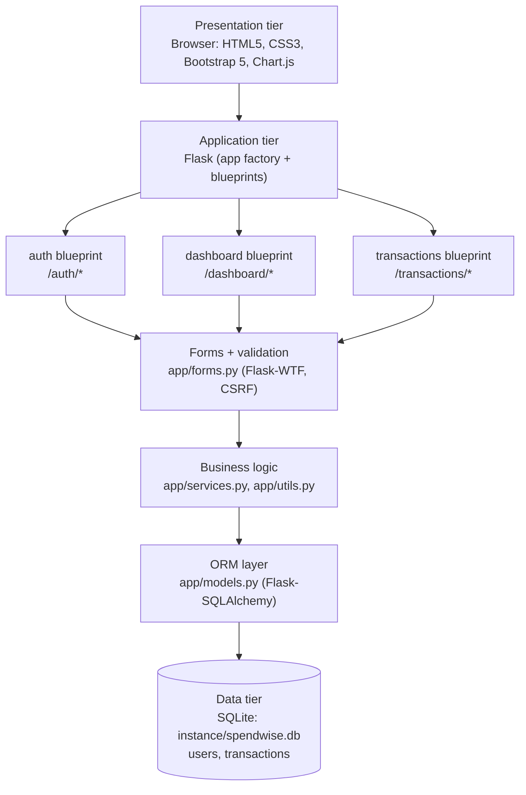
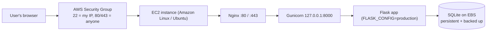
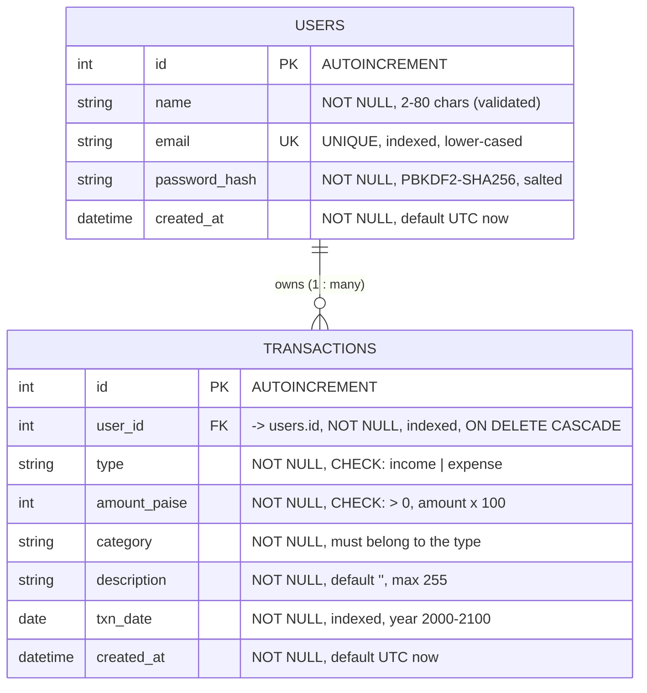
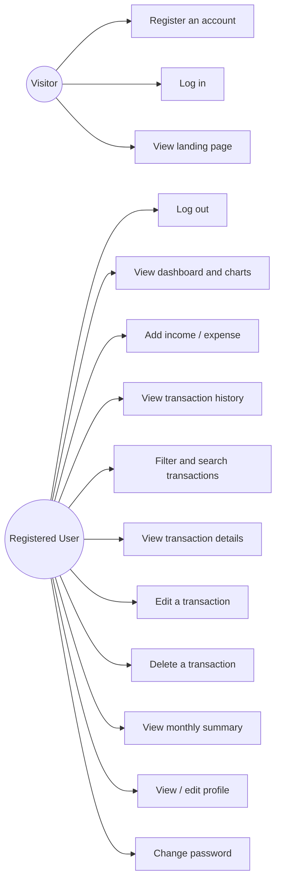
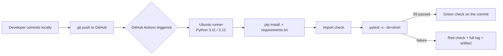

# SpendWise — Personal Expense Tracker

## Capstone Project Report

---

## Title Page

| Field | Value |
| --- | --- |
| **Project Title** | SpendWise — Personal Expense Tracker |
| **Submitted by** | _[Your full name]_ |
| **Roll number / Registration number** | _[Your roll number]_ |
| **Course** | Bachelor of Computer Applications (BCA) |
| **Semester / Year** | _[e.g. Semester VI, 2026]_ |
| **Subject / Paper** | Capstone Project Development / Cloud Development using Amazon AWS / DevOps using GitHub and GitHub Actions |
| **Guide / Supervisor** | _[Guide's name and designation]_ |
| **Department** | _[Department name]_ |
| **College / Institute** | _[College name]_ |
| **University** | _[University name]_ |
| **Academic year** | _[e.g. 2025–2026]_ |
| **Date of submission** | _[DD/MM/YYYY]_ |

> **Placeholders:** every value in square brackets and every _italic placeholder_ must be
> replaced with your own information. Do not submit this report with the placeholders
> still in it.

---

## Declaration

I hereby declare that the project work entitled **"SpendWise — Personal Expense
Tracker"** submitted by me is my own work carried out under the guidance of
_[Guide's name]_. The source code, database schema, test suite and documentation in this
report were developed by me. All sources of information that I have used are
acknowledged in the References section.

**Signature:** __________________ **Date:** ______________

---

## Acknowledgement

I sincerely thank my project guide _[Guide's name]_ for the continuous guidance and
valuable suggestions during the development of this project. I also thank the Head of the
Department and all faculty members for their support, and my family and friends for their
encouragement.

---

## Abstract

SpendWise is a web-based personal expense tracker designed to help an individual record
day-to-day income and expenses and to understand where the money is going. Many students
and salaried people keep this information in notebooks, in chat messages or in memory,
which makes it difficult to answer simple questions such as *"How much did I spend on food
this month?"* or *"Is my balance positive?"*. SpendWise solves this with a simple,
mobile-friendly dashboard.

The application is built with **Python Flask** on the server, **SQLite** as the database
through **Flask-SQLAlchemy**, and **Bootstrap 5** with **Chart.js** on the client. Users
create an account, log in securely (passwords are hashed with Werkzeug), and then manage
their own transactions: add, view, edit and delete income and expense records, filter them
by type, category, description and date range, and see summaries on the dashboard. Every
calculation — total income, total expenses, remaining balance, current-month figures,
monthly income-versus-expense series and the category-wise breakdown — is performed on the
server, using only the records of the logged-in user.

Three subject areas of the BCA syllabus are integrated in this single project:

1. **Capstone Project Development** — a complete CRUD web application with
   authentication, server-side validation, reports, custom error pages and an automated
   test suite of **99 pytest tests**.
2. **Cloud Development using Amazon AWS** — a documented deployment path to an
   **Amazon EC2** Linux instance running **Gunicorn** behind **Nginx**, managed by
   **systemd**, with cost, security-group and backup planning.
3. **DevOps using GitHub and GitHub Actions** — a Git repository and a
   **GitHub Actions CI workflow** that installs the dependencies and runs the whole test
   suite on every push and pull request.

Money amounts are stored as **integer paise** instead of floating-point numbers, so
rupee-level rounding errors cannot occur. Security was treated as a first-class
requirement: CSRF protection on every form, ownership checks on every record (never
trusting an id from the URL), environment-based secret configuration and secure
production cookie settings.

---

## 1. Introduction

### 1.1 Background

Personal finance management is a daily activity for every student and working person.
Income arrives once a month, but expenses happen many times a day — canteen food,
transport, mobile recharge, books, medicine, rent. When these are not recorded, it is
impossible to answer questions like:

- How much money came in this month?
- How much went out, and on what?
- Which category is eating the largest share of my money?
- Is my balance positive?

Traditional solutions are a paper notebook (easy to lose, hard to total) or a
spreadsheet (needs manual formulas, not accessible from a phone).

### 1.2 What SpendWise is

SpendWise is a **web application** that runs in any modern browser. The user registers an
account, logs in, and then records income and expenses. The server calculates all totals,
so the numbers are always consistent with the stored data. The dashboard shows the
current financial position at a glance, and interactive charts show monthly trends and
category-wise spending.

### 1.3 Why a web application

- Works on a laptop, tablet and mobile browser without installing anything
- Data is stored centrally on a server, so it is not lost when the device changes
- The same code can later be deployed to the cloud (Amazon AWS) with no changes to the
  application logic
- It demonstrates a full three-tier architecture — presentation, application, data —
  which is exactly what an academic capstone project should cover

### 1.4 Currency and scope

The default display currency is the **Indian Rupee (₹)**, formatted with Indian digit
grouping (for example `₹1,23,45,678.90`). The project is a single-currency, single-user-
per-account application; group or family sharing is out of scope (see section 5).

---

## 2. Problem Statement

Manual tracking of personal expenses is unreliable and time-consuming:

1. **Data is scattered** — some expenses are remembered, some are written on paper, some
   are in chat messages. There is no single place to look.
2. **Totalling is error-prone** — adding a month of entries by hand or with a fragile
   spreadsheet formula produces wrong balances.
3. **No visual insight** — even when data exists, a plain list does not show trends or
   which category dominates the spending.
4. **Not portable** — a notebook cannot be searched or filtered; a spreadsheet is awkward
   on a phone.
5. **No security or privacy** — a paper notebook has no access control, and a shared
   spreadsheet exposes everything to everyone.
6. **Rounding errors** — many simple trackers use floating-point arithmetic
   (`0.1 + 0.2 = 0.30000000000000004`), which is unacceptable for money.

**Therefore**, there is a need for a simple, secure, server-backed expense tracker that
records transactions reliably, computes all totals on the server with exact money
arithmetic, gives visual insights, and enforces per-user privacy.

---

## 3. Objectives

### 3.1 Primary objectives

1. To design and develop a web application (**SpendWise**) for recording personal income
   and expenses.
2. To implement secure user registration, login, logout and profile management with
   hashed password storage and session-based authentication.
3. To implement complete **CRUD** (Create, Read, Update, Delete) operations for
   transactions with server-side validation.
4. To calculate total income, total expenses, remaining balance, current-month totals,
   a monthly income-versus-expense series and a category-wise expense breakdown — all on
   the server and strictly per user.
5. To present these figures on a responsive dashboard with **Chart.js** visualisations,
   filtered lists and a monthly summary view.
6. To protect user data by enforcing authentication and **ownership checks** on every
   route, including custom 403 and 404 handling.
7. To write an automated test suite with **pytest** that covers authentication,
   transactions, dashboard mathematics, security and error handling.
8. To set up version control with **Git/GitHub** and a **GitHub Actions** CI workflow that
   runs the test suite automatically.
9. To document a cost-aware deployment path to **Amazon AWS EC2**.

### 3.2 Secondary objectives

10. To avoid floating-point errors in money calculations by using integer paise.
11. To provide a professional, presentable user interface suitable for a college
    demonstration on desktop, tablet and mobile.
12. To keep the project dependency-light (no Docker, no Kubernetes, no paid service).

---

## 4. Scope and Limitations

### 4.1 Scope (what the system does)

| Area | Included |
| --- | --- |
| Users | Registration, login, logout, profile view/edit, password change |
| Transactions | Add income, add expense, list, view details, edit, delete |
| Filters | Transaction type, category, description/category search, date range, pagination |
| Reports | All-time income/expense/balance, current-month income/expense, 6-month income-vs-expense series, category-wise breakdown, monthly summary view |
| Charts | Monthly bar chart and category-wise doughnut chart, rendered from the logged-in user's data |
| Error handling | Custom 400, 403, 404 and 500 pages |
| Testing | 99 automated pytest tests on an isolated temporary database |
| DevOps | Git repository + GitHub Actions CI workflow |
| Cloud | Documented deployment to Amazon EC2 (Gunicorn + Nginx + systemd) — performed manually by the student, not automated by the application |

### 4.2 Limitations (what the system does not do)

- SQLite is a single-file database, adequate for a single-user academic demonstration but
  not designed for many concurrent writers; it is not a high-availability database.
- No email verification, no "forgot password" by email, no two-factor authentication.
- No multi-currency conversion; the display currency is INR only.
- No automatic bank/UPI integration; entries are manual.
- No recurring transactions, budgets or spending limits.
- A single account represents a single person; there is no shared or family account.
- A single transaction amount is capped at `₹10,00,00,000` by a validation rule.
- The charts display the last six months; older data is reachable only through filters and
  the monthly summary view.
- The application was verified locally on Windows. Deployment to AWS is documented but was
  performed on the student's own account, so any cloud screenshots must be captured by the
  student after deployment.

---

## 5. Existing System and Proposed System

### 5.1 Existing systems

| Existing approach | Problems |
| --- | --- |
| Paper notebook | Easy to lose; cannot search, filter or total; no backup; no access control |
| MS Excel / Google Sheets | Manual formulas; one wrong formula silently corrupts the balance; awkward on a phone; no proper per-user access control; no visual dashboard by default |
| Mobile note apps | No structure (category, type, date); no arithmetic; no reports |
| Existing online trackers | Often paid, may require bank linkage, data privacy unclear, and they cannot be modified/submitted as a college project |

### 5.2 Proposed system (SpendWise)

| Feature | SpendWise |
| --- | --- |
| Data entry | Structured web form: type, amount, category, date, description |
| Validation | On the server, always — rejects zero/negative amounts, invalid dates, invalid types, unknown categories and over-long descriptions |
| Storage | SQLite through an ORM, with foreign keys, unique email, and CHECK constraints |
| Money arithmetic | Integer paise — no floating-point rounding errors |
| Access control | Session-based login (Flask-Login) + ownership verification on every record |
| Reporting | Server-side totals: all-time and current month, clearly labelled |
| Visualisation | Interactive Chart.js charts built from the authenticated user's own data |
| Security | Hashed passwords, CSRF protection on every form, secure production cookies, no hardcoded secrets |
| Quality | 99 automated tests + continuous integration on GitHub |
| Cost | Free and open tools only; the cloud deployment uses AWS Free Tier where eligible |

**Advantages of the proposed system:** accurate money maths, secure per-user data, visual
insight, searchable and filterable history, no manual calculations, and an architecture
that can be deployed to the cloud without changing the application code.

---

## 6. Requirements

### 6.1 Functional requirements

| ID | Requirement |
| --- | --- |
| FR-1 | The system shall allow a visitor to register with a name, a unique email address, a password of at least 8 characters and a matching confirmation. |
| FR-2 | The system shall reject a registration that uses an email address that is already registered. |
| FR-3 | The system shall authenticate a user by email and password and create a session. |
| FR-4 | The system shall allow a logged-in user to log out; logout shall be a POST request protected by CSRF. |
| FR-5 | The system shall deny access to private pages for users who are not logged in and redirect them to the login page. |
| FR-6 | The system shall let a logged-in user add an income or an expense transaction with amount, category, date and description. |
| FR-7 | The system shall let a user view a list of their own transactions with pagination. |
| FR-8 | The system shall let a user view the details of a single transaction that they own. |
| FR-9 | The system shall let a user edit a transaction that they own. |
| FR-10 | The system shall let a user delete a transaction that they own, using a POST request with a confirmation step. |
| FR-11 | The system shall filter transactions by type, category, description/category search text and a date range. |
| FR-12 | The system shall display total income, total expenses and the remaining balance (all-time) for the logged-in user. |
| FR-13 | The system shall display the current-month income and current-month expenses for the logged-in user. |
| FR-14 | The system shall display a monthly income-versus-expense chart for the last six months. |
| FR-15 | The system shall display a category-wise expense breakdown with percentages. |
| FR-16 | The system shall display a monthly summary view for any month selected by the user. |
| FR-17 | The system shall let a user update their display name and change their password after verifying the current password. |
| FR-18 | The system shall never allow one user to read, edit or delete another user's transactions or profile. |
| FR-19 | The system shall show friendly success and error messages and meaningful empty states. |
| FR-20 | The system shall render custom 400, 403, 404 and 500 error pages. |
| FR-21 | The system shall provide an optional seed script that creates demo data exactly once (idempotent). |
| FR-22 | The system shall expose chart data as JSON so charts can be reloaded with JavaScript. |

### 6.2 Non-functional requirements

| ID | Requirement |
| --- | --- |
| NFR-1 | **Security.** Passwords stored only as salted hashes (PBKDF2-SHA256 via Werkzeug). |
| NFR-2 | **Security.** CSRF protection on every state-changing request. |
| NFR-3 | **Security.** All user input validated on the server, not only in the browser. |
| NFR-4 | **Security.** Secrets read from environment variables; no secret committed to Git. |
| NFR-5 | **Security.** In production, `DEBUG` off and session cookies flagged `Secure`, `HttpOnly`, `SameSite=Lax`. |
| NFR-6 | **Correctness.** Monetary totals must be exact — integer paise, never floating point. |
| NFR-7 | **Correctness.** A user's totals must include all and only their own records (no double counting, no cross-user leakage). |
| NFR-8 | **Responsiveness.** The interface must be usable on desktop, tablet and mobile browsers. |
| NFR-9 | **Usability.** Every action gives clear feedback; empty states explain what to do next. |
| NFR-10 | **Maintainability.** Layered code structure (routes / forms / services / models) with clear file responsibilities. |
| NFR-11 | **Testability.** An isolated temporary database for tests; the suite must run with one command (`pytest`). |
| NFR-12 | **Portability.** Runs on Windows for development and on Linux for production (Gunicorn added separately). |
| NFR-13 | **Cost.** Only free and open-source tools; AWS deployment must fit within Free Tier wherever possible. |
| NFR-14 | **Observability.** Safe logging of application events without ever logging passwords or secrets. |

### 6.3 Hardware and software requirements

**Development machine (as used)**

| Item | Value |
| --- | --- |
| Operating system | Windows 11 (64-bit) |
| Processor / RAM | Any dual-core processor, 4 GB RAM or more |
| Python | 3.13.4 (`python --version`) |
| pip | 25.1.1 |
| Editor | Visual Studio Code |
| Browser | Chrome / Edge (any modern browser) |

**Production (planned)**

| Item | Value |
| --- | --- |
| Cloud | Amazon Web Services (AWS) |
| Service | Amazon EC2 |
| Instance type | `t3.micro` (or `t2.micro` in the Free Tier) |
| Operating system | Linux (Amazon Linux 2023 or Ubuntu 24.04 LTS) |
| Application server | Gunicorn 23.0.0 (WSGI) |
| Reverse proxy | Nginx (optional but recommended) |
| Process manager | systemd (`spendwise.service`) |
| Storage | 8 GiB EBS `gp3` volume holding the SQLite file |

---

## 7. Technology Stack

| Layer | Technology | Version | Why it was chosen |
| --- | --- | --- | --- |
| Mark-up | HTML5 | — | Standard, semantic structure |
| Styling | CSS3 + Bootstrap 5 | 5.3.3 | Fast, responsive grid and components; professional look |
| Icons | Bootstrap Icons | 1.11.3 | Consistent icon set |
| Client scripting | JavaScript (ES6) | — | Forms, sidebar toggle, delete modal, chart wiring |
| Charts | Chart.js | 4.4.3 | Lightweight, interactive bar and doughnut charts |
| Programming language | Python | 3.11+ (tested on 3.13.4) | Required by Flask; readable and beginner-friendly |
| Web framework | Flask | 3.0.3 | Minimal, explicit, ideal for learning the request/response cycle |
| ORM | Flask-SQLAlchemy / SQLAlchemy | 3.1.1 / 2.0.35 | Models instead of hand-written SQL; prevents SQL injection |
| Database | SQLite | bundled with Python | Zero configuration, file-based, perfect for a single-server academic project |
| Authentication | Flask-Login | 0.6.3 | Sessions, `current_user`, `@login_required` |
| Forms and validation | Flask-WTF / WTForms | 1.2.1 / 3.1.2 | Server-side validation and CSRF in one place |
| Email validation | email-validator | 2.2.0 | Correct email syntax checking |
| Password hashing | Werkzeug security | 3.0.4 | Salted PBKDF2-SHA256 |
| Configuration | python-dotenv | 1.0.1 | Reads `.env` without hardcoding secrets |
| Testing | pytest | 8.3.3 | Simple fixtures; ideal for Flask test clients |
| Version control | Git + GitHub | — | History, backup, collaboration, CI trigger |
| Continuous integration | GitHub Actions | — | Runs the test suite on every push/PR |
| Production server | Gunicorn | 23.0.0 | Production WSGI server (Linux only) |
| Reverse proxy | Nginx | — | Static files, HTTPS termination, proxy to Gunicorn |

**Deliberately NOT used:** Docker, Kubernetes, any paid service, any payment gateway.

---

## 8. System Architecture

SpendWise follows a classic **three-tier architecture** (presentation, application, data)
and Flask's **application-factory + blueprint** pattern.



### 8.1 Layer responsibilities

| Layer | Files | Responsibility |
| --- | --- | --- |
| Presentation | `app/templates/**`, `app/static/**` | Render pages, styles, JavaScript and charts. Contains no business logic. |
| Routing / controllers | `app/auth/routes.py`, `app/dashboard/routes.py`, `app/transactions/routes.py` | Handle HTTP requests, enforce `@login_required` and ownership, call the logic layer, choose a template. |
| Validation | `app/forms.py` | Server-side validation, CSRF, friendly field-level messages. |
| Business logic | `app/services.py`, `app/utils.py`, `app/constants.py` | All totals and reports; money conversion and INR formatting; category/type constants. |
| Data access | `app/models.py` | `User` and `Transaction` models, relationships, constraints, password hashing. |
| Configuration | `config.py`, `.env`, `.env.example` | Three configurations (development, testing, production) and environment-based secrets. |
| Entry points | `run.py`, Flask CLI | Start the development server locally; `init-db` and `create-user` commands. |

### 8.2 Request flow for a typical page

1. Browser sends `GET /dashboard/` with the session cookie.
2. Flask-Login resolves the session cookie into `current_user`; if the visitor is not
   logged in, `@login_required` redirects to `/auth/login` with a friendly message.
3. The dashboard view calls `get_summary()`, `monthly_series()`, `category_breakdown()`
   and `recent_transactions()` from `app/services.py`, always passing `current_user.id`.
4. The service layer issues SQLAlchemy queries filtered by `user_id` and receives rows.
5. Amounts are formatted as INR through the `inr` Jinja filter.
6. Jinja renders the HTML; the chart data is embedded in `data-chart` attributes.
7. Chart.js (client side) reads the JSON and draws the bar and doughnut charts.

### 8.3 Deployment architecture (planned)



Full details, including costs, are in [docs/aws_deployment_guide.md](aws_deployment_guide.md).

---

## 9. Database Design

### 9.1 Design decisions

1. **Two tables.** `users` and `transactions`, linked one-to-many.
2. **Money as integer paise.** `transactions.amount_paise` stores `amount × 100` as an
   integer. `0.1 + 0.2` problems therefore cannot occur. Conversion and `ROUND_HALF_UP`
   rounding live in `app/utils.py`.
3. **Ownership on every row.** `transactions.user_id` is a non-null foreign key with an
   index; every query in the application filters on it.
4. **Unique email.** `users.email` has a `UNIQUE` constraint and an index, so duplicate
   accounts are impossible even if the application check is bypassed.
5. **Database-level CHECK constraints.** `amount_paise > 0` and
   `type IN ('income', 'expense')` protect the data even in the face of a future code bug.
6. **Sensible defaults and nullability.** `created_at` defaults to the current UTC time;
   `description` defaults to an empty string; required fields are `NOT NULL`.

### 9.2 ER diagram



### 9.3 Table: `users`

| Column | Type | Constraints | Description |
| --- | --- | --- | --- |
| `id` | INTEGER | PRIMARY KEY | Auto-increment identifier |
| `name` | VARCHAR(80) | NOT NULL | Full name of the user |
| `email` | VARCHAR(120) | NOT NULL, UNIQUE, INDEXED | Login identifier, stored lower-cased |
| `password_hash` | VARCHAR(255) | NOT NULL | Salted PBKDF2-SHA256 hash — never the plain password |
| `created_at` | DATETIME | NOT NULL | Registration timestamp (UTC) |

**Relationships**

- `User.transactions` → one-to-many to `Transaction` with
  `cascade="all, delete-orphan"`, so deleting a user removes their transactions.

### 9.4 Table: `transactions`

| Column | Type | Constraints | Description |
| --- | --- | --- | --- |
| `id` | INTEGER | PRIMARY KEY | Auto-increment identifier |
| `user_id` | INTEGER | NOT NULL, FOREIGN KEY → `users.id`, INDEXED, ON DELETE CASCADE | Owner of the record (taken from the session, never from a form) |
| `type` | VARCHAR(10) | NOT NULL, CHECK `type IN ('income','expense')` | Income or expense |
| `amount_paise` | INTEGER | NOT NULL, CHECK `amount_paise > 0` | Amount × 100 (integer paise) |
| `category` | VARCHAR(50) | NOT NULL | Must belong to the selected type (validated in `TransactionForm.validate_category`) |
| `description` | VARCHAR(255) | NOT NULL, DEFAULT `''` | Free text, maximum 255 characters |
| `txn_date` | DATE | NOT NULL, INDEXED | Date the income/expense happened |
| `created_at` | DATETIME | NOT NULL | Row creation timestamp (UTC) |

### 9.5 Categories

**Income categories (8):** Salary, Business, Freelance, Interest, Investment, Rental,
Gift, Other Income

**Expense categories (12):** Food, Rent, Groceries, Transport, Utilities, Education,
Health, Entertainment, Shopping, Travel, Insurance, Other Expense

Income and expense categories are kept in separate groups so that a category can never be
used with the wrong transaction type.

### 9.6 Database initialisation and demo data

| Task | Command |
| --- | --- |
| Create the tables | `flask --app run.py init-db` |
| Create one user | `flask --app run.py create-user` |
| Insert demo data (once) | `python scripts\seed_data.py` |
| Rebuild demo data | `python scripts\seed_data.py --force` |

The seed script is **idempotent**: running it a second time prints
*"Demo account already exists … Nothing was added, so records were not duplicated."* and
exits, so duplicate rows are impossible.

The database file lives at `instance/spendwise.db` and is **not** tracked by Git. Data
therefore persists across application restarts but is never uploaded to GitHub — which is
also why real financial records are never published.

---

## 10. Use-Case Diagram



### Use-case descriptions (selected)

**UC1 — Register an account**
*Actor:* Visitor.
*Precondition:* not logged in.
*Main flow:* open `/auth/register` → fill name, email, password, confirm password →
submit → server validates → user row created with a hashed password → user logged in
automatically → redirected to the dashboard with a success message.
*Alternate flows:* the email already exists → "This email is already registered";
passwords do not match → "Both passwords must match"; password shorter than 8 characters
→ "Password must be at least 8 characters long"; invalid email → "Enter a valid email
address."

**UC6 — Add income / expense**
*Actor:* Logged-in user.
*Main flow:* open `/transactions/add` → choose type, amount, category, date, description →
submit → server validates → row inserted with `user_id = current_user.id` → success
message → redirected to the transaction list.
*Alternate flows:* amount 0 or negative → rejected; category not matching the type →
rejected; date outside 2000–2100 → rejected; description longer than 255 characters →
rejected.

**UC10/UC11 — Edit / delete a transaction**
*Main flow:* open `/transactions/<id>/edit` (or POST to `/transactions/<id>/delete`) →
the server loads the row → if it does not exist, **404**; if it belongs to another user,
**403** with a warning logged → otherwise the update/delete is applied.
*Postcondition:* the data changes only for its legitimate owner.

**UC5 — View dashboard and charts**
*Main flow:* open `/dashboard/` → the server computes all-time and current-month totals,
the six-month series and the category breakdown from the user's own records → the template
renders the cards and embeds chart JSON → Chart.js draws the charts.
*Alternate flow:* the user has no transactions → an empty state is shown instead of
misleading charts.

---

## 11. Module Descriptions

### 11.1 Module 1 — Application factory and configuration

**Files:** `app/__init__.py`, `config.py`, `run.py`, `.env`, `.env.example`

- `create_app()` builds and returns a fully configured Flask application, which makes the
  code testable and Gunicorn-friendly.
- Extensions (`db`, `login_manager`, `csrf`) are created once and bound to the app.
- Three configurations: **Development** (debug on, local SQLite),
  **Testing** (temporary database, CSRF off by default) and **Production** (debug off,
  secure cookies, and a `validate()` method that **refuses to start** with a missing or
  placeholder secret key).
- Blueprints, error handlers, template helpers (the `inr` filter and constants) and
  logging are registered here.
- Two CLI commands: `init-db` and `create-user`.

### 11.2 Module 2 — Authentication and profile

**Files:** `app/auth/routes.py`, `app/forms.py` (`RegisterForm`, `LoginForm`,
`ProfileForm`, `ChangePasswordForm`), `app/models.py` (`User`)

- Registration with unique-email and password-confirmation validation.
- Login with session creation; the "next" parameter is validated to prevent open
  redirects; unknown email and wrong password produce the *same* message.
- Logout is a **POST** route so it is CSRF-protected.
- Profile: update the display name; change the password after verifying the current one
  and rejecting a new password identical to the old one.
- Passwords are hashed with `generate_password_hash` (salted PBKDF2-SHA256); the plain
  password is never stored or logged.

### 11.3 Module 3 — Transaction management

**Files:** `app/transactions/routes.py`, `app/forms.py` (`TransactionForm`),
`app/templates/transactions/*`

- `index` — paginated history with filters: type, category, free-text search over the
  description and category, and a date range (a reversed range is swapped automatically).
- `add` — creates a record; `user_id` comes from the session, never from the form.
- `detail` — shows one record.
- `edit` — updates a record the user owns.
- `delete` — POST-only, with a Bootstrap confirmation modal.
- Every route goes through `get_owned_transaction_or_404()`, which returns **404** for a
  missing record and **403** (plus a logged warning) for somebody else's record.

### 11.4 Module 4 — Dashboard, reports and charts

**Files:** `app/dashboard/routes.py`, `app/services.py`,
`app/templates/dashboard/*`, `app/static/js/charts.js`

- `get_summary()` — all-time income, all-time expense, balance, current-month income,
  current-month expense, current-month balance, transaction count and a `has_data` flag.
- `monthly_series()` — the last six calendar months, oldest first, with missing months
  zero-filled and each transaction counted exactly once.
- `category_breakdown()` — per-category totals, biggest first, with a percentage and a
  chart colour.
- `recent_transactions()` — the latest records for the dashboard table.
- `get_month_summary()` — the figures for one selected month (monthly summary view).
- `/dashboard/api/chart-data` returns the same numbers as JSON.
- All money values are returned in paise and formatted with Indian digit grouping in the
  template through the `inr` filter.

**Clear metric definitions (no ambiguity, no double counting):**

| Metric | Meaning |
| --- | --- |
| Total income / Total expenses / Balance | **All time** — every transaction of the user, ever |
| Current-month income / expense / balance | Only the **current calendar month** |
| Monthly chart series | The **last six calendar months**, grouped by year-month |
| Category breakdown | **All time** by default; the monthly summary view passes a date range so it becomes that month |

### 11.5 Module 5 — Front-end and user experience

**Files:** `app/templates/**`, `app/static/css/style.css`, `app/static/js/app.js`,
`app/static/js/charts.js`, `app/static/js/transactions.js`

- Bootstrap 5 grid with a fixed sidebar on desktop and a collapsible sidebar on mobile.
- Four dashboard stat cards: Total Income, Total Expenses, Balance, current-month figures.
- Empty states when there is no data (a friendly prompt to add the first transaction
  instead of empty charts).
- Flash messages in four categories (success / danger / warning / info).
- Custom 400, 403, 404 and 500 error pages.
- A small `transactions.js` enhancement that shows only the relevant category group when
  the transaction type changes.

### 11.6 Module 6 — Testing and quality

**Files:** `tests/conftest.py`, `tests/test_auth.py`, `tests/test_transactions.py`,
`tests/test_dashboard.py`, `tests/test_security.py`, `tests/test_errors.py`, `pytest.ini`

- Fixtures build a temporary SQLite file in the OS temp folder and delete it after the run.
- Helpers: `make_user`, `make_transaction`, `login`, `logout`, `rupees`.
- Covers the happy paths, the validation failures, the ownership rules, the dashboard
  mathematics, the security properties and the error pages.

### 11.7 Module 7 — DevOps and cloud

**Files:** `.github/workflows/tests.yml`, `scripts/seed_data.py`,
`docs/aws_deployment_guide.md`, `ARCHITECTURE.md`

- The CI workflow installs `requirements.txt` on Ubuntu and runs `pytest` under Python
  3.11 and 3.12 on every push and pull request — no secrets, no AWS credentials.
- The seed script creates realistic demo data once.
- The AWS guide covers cost review, security groups, Gunicorn, systemd, Nginx, backups,
  updates and cleanup.

---

## 12. Security

### 12.1 Threats considered and the countermeasures

| Threat | Countermeasure | Where |
| --- | --- | --- |
| Password theft from the database | Salted PBKDF2-SHA256 hashing; plain passwords are never stored or logged | `app/models.py` |
| Cross-Site Request Forgery (CSRF) | `CSRFProtect` on the whole app; `form.hidden_tag()` in every POST form; state-changing actions are POST-only (delete, logout) | `app/__init__.py`, `app/forms.py`, templates |
| Cross-Site Scripting (XSS) | Jinja2 auto-escaping is left enabled; user text is never rendered as HTML | templates |
| SQL injection | Only the SQLAlchemy query API is used — no SQL is built by string concatenation | all models/queries |
| Horizontal privilege escalation (reading another user's data) | Every query filters on `user_id = current_user.id`; a transaction id from the URL is verified against the owner | `app/transactions/routes.py`, `app/services.py` |
| Insecure direct object reference | `get_owned_transaction_or_404()` → 404 for missing, 403 for another owner *with a warning logged* | `app/transactions/routes.py` |
| Open redirect | The `next` parameter is validated with `urljoin`/`urlparse` and must stay on the same host | `app/auth/routes.py` |
| Account enumeration | The same message for an unknown email and a wrong password | `app/auth/routes.py` |
| Session hijacking | `HttpOnly`, `SameSite=Lax`, and `Secure` cookies in production | `config.py` |
| Secret leakage | Secrets come only from environment variables / `.env`; `.env`, `*.db`, `*.pem`, `*.key`, `.aws/` are git-ignored; `ProductionConfig.validate()` refuses a placeholder secret | `config.py`, `.gitignore` |
| Information disclosure through errors | Custom 400/403/404/500 pages; no traceback shown to users (it is logged instead) | `app/__init__.py`, `app/templates/errors/*` |
| Weak input | Server-side validation of amount, type, category, date and description length | `app/forms.py` |
| Money arithmetic errors | Integer paise with explicit `ROUND_HALF_UP` rounding | `app/utils.py` |
| Data loss | Documented SQLite backup procedure (`.backup` + cron) | `docs/aws_deployment_guide.md` |
| Brute-force login | _Not implemented in this version_ — see Future Scope | — |

### 12.2 Ownership rule (the single most important rule in the project)

```
A transaction id that arrives in a URL or a form is NEVER trusted.
1. Load the record by id.
2. If it does not exist                        -> HTTP 404 (not found)
3. If it exists but belongs to another user    -> HTTP 403 (forbidden) + warning log
4. Otherwise                                   -> the operation is allowed
```

`user_id` for a **new** record always comes from `current_user.id` (the session), never
from a hidden form field. The automated tests `test_cannot_view_another_users_transaction`,
`test_cannot_edit_another_users_transaction`, `test_cannot_delete_another_users_transaction`
and `test_transaction_history_is_isolated_between_users` prove this behaviour.

### 12.3 Production hardening checklist

- ☐ `FLASK_CONFIG=production` (so `DEBUG` is off)
- ☐ A strong, randomly generated `SECRET_KEY` supplied through the environment only
- ☐ `SESSION_COOKIE_SECURE=True` (already set in `ProductionConfig`) and HTTPS in front
- ☐ Nginx in front of Gunicorn; **never** expose the Flask development server
- ☐ SSH (port 22) restricted to your own IP; only 80/443 open publicly
- ☐ `chmod 600` on the environment file that holds the secret key
- ☐ Daily database backups, with at least one copy off the instance
- ☐ No `.env`, `.pem` or `.db` file inside the Git repository

---

## 13. Testing: Methodology and Results

### 13.1 Methodology

| Aspect | Approach |
| --- | --- |
| Framework | pytest 8.3.3 with the Flask test client |
| Configuration | `pytest.ini` — `testpaths = tests`, `pythonpath = .`, `addopts = -v --tb=short` |
| Isolation | `tests/conftest.py` sets `TEST_DATABASE_URL` to a SQLite file inside the OS temp folder and deletes it in `pytest_sessionfinish`. **The real database is never touched.** |
| CSRF in tests | Disabled by default in `TestingConfig` so forms can be posted easily; `tests/test_security.py` re-enables it mid-test to prove that CSRF protection really blocks a request without a token |
| Fixtures | `app`, `client`, `make_user`, `make_transaction`, `login`, `logout`, `rupees` |
| Test types | Unit (money helpers, service functions), integration (routes + database), security (CSRF, cookies, hashing, injection), negative (invalid input, wrong owner, empty state), error handling |

### 13.2 Test modules and what they verify

| Module | Tests | Focus |
| --- | --- | --- |
| `tests/test_auth.py` | 25 | Landing/login/register pages, registration rules (duplicate email, password mismatch, short password, invalid email, email case normalisation), login success/failure, logout (POST-only), route protection, profile view/update, password change, hash storage |
| `tests/test_transactions.py` | 32 | Add expense/income, owner taken from the session, rounding, zero/negative/non-numeric amounts, invalid type/date/category/description, detail view, edit/update, delete (POST-only), cross-user 403, history isolation, all filters, reversed date range, empty filter result, pagination |
| `tests/test_dashboard.py` | 21 | Empty dashboard, all-time and current-month totals, balance, "no double counting", category percentages and ordering, six-month series with zero-filled months, dashboard cards, isolation between users, chart-data JSON (structure, authentication, empty payload), monthly summary views and invalid parameters, transaction count |
| `tests/test_security.py` | 15 | CSRF enabled/disabled behaviour, session cookie flags, production secret validation, DEBUG and Secure flags in production, salted hashes, no plaintext password in the database, injection-safe search, generic login error, open-redirect protection, repository hygiene (`.gitignore`, `.env.example`) |
| `tests/test_errors.py` | 6 | Custom 400/403/404/500 pages, no traceback leaked to the user |
| **Total** | **99** | |

### 13.3 Actual results

**Command run (from the project folder, with the virtual environment active):**

```powershell
pytest
```

**Actual observed output of the final local run on Windows:**

```
============================= test session starts =============================
platform win32 -- Python 3.13.4, pytest-8.3.3
rootdir: C:\Users\ASUS\OneDrive\Documents\Trae\temp_20261029_01\spendwise
configfile: pytest.ini
testpaths: tests
collected 99 items

tests/test_auth.py .........................                             [ 25%]
tests/test_dashboard.py .....................                            [ 46%]
tests/test_errors.py ......                                              [ 52%]
tests/test_security.py ...............                                   [ 68%]
tests/test_transactions.py ................................              [100%]

============================= 99 passed in 39.34s =============================
```

| Result | Value |
| --- | --- |
| Tests collected | 99 |
| Tests passed | **99** |
| Tests failed | 0 |
| Execution time | ≈ 39 seconds |
| Environment | Windows, Python 3.13.4, pytest 8.3.3, isolated temporary SQLite database |

> **Honesty note:** the numbers above are the observed result of the local test run. No
> performance benchmark, load test or cloud deployment result is claimed anywhere in this
> report, because none of those were performed. When you re-run `pytest` on your own
> machine, replace this table with your own captured output — the count may change if you
> add more tests.

### 13.4 Additional manual verification performed locally

| # | Check | Result |
| --- | --- | --- |
| 1 | `flask --app run.py init-db` | Database tables created |
| 2 | `python scripts\seed_data.py` | Demo account created with 64 transactions over 4 months |
| 3 | Landing page `http://127.0.0.1:5000/` | HTTP 200, SpendWise branding rendered |
| 4 | `/auth/login` | HTTP 200, form rendered |
| 5 | `/dashboard/` while logged out | HTTP 302 redirect to the login page (private page protected) |
| 6 | `pytest` | 99 passed |

### 13.5 Sample test cases (black-box)

| ID | Precondition | Steps | Expected result | Actual result |
| --- | --- | --- | --- | --- |
| TC-01 | Not logged in | Open `/dashboard/` | Redirect to `/auth/login` with a message | Pass |
| TC-02 | — | Register with an email that already exists | Error "This email is already registered" | Pass |
| TC-03 | — | Register with password `abc` | Error "Password must be at least 8 characters long" | Pass |
| TC-04 | Registered | Log in with a wrong password | Error "Invalid email or password" | Pass |
| TC-05 | Logged in | Add an expense of `250.50` | Saved; displayed as `₹250.50`; totals updated | Pass |
| TC-06 | Logged in | Add an expense of `0` | Error "Amount must be greater than 0" | Pass |
| TC-07 | Logged in | Add an expense of `-50` | Rejected by validation | Pass |
| TC-08 | Logged in | Add `Salary` under type `Expense` | Error "Please choose a category that matches the selected transaction type" | Pass |
| TC-09 | Logged in | Add a description of 300 characters | Error "Description cannot be longer than 255 characters" | Pass |
| TC-10 | Logged in | Set the date to year 1990 | Error "Date must be between the years 2000 and 2100" | Pass |
| TC-11 | Logged in | Edit an owned transaction | Updated; success message | Pass |
| TC-12 | Logged in | Delete an owned transaction (POST) | Deleted; success message | Pass |
| TC-13 | Logged in as A | Open `/transactions/<id of B>/edit` | HTTP 403 | Pass |
| TC-14 | Logged in as A | Open `/transactions/99999` | HTTP 404 | Pass |
| TC-15 | Logged in | Filter by type = Expense | Only expenses listed | Pass |
| TC-16 | Logged in | Filter from 2026-10-31 to 2026-10-01 | Range swapped automatically; results shown | Pass |
| TC-17 | Logged in | Search `salary` | Matching rows only | Pass |
| TC-18 | New account, no data | Open `/dashboard/` | Empty state; all totals `₹0.00`; no errors | Pass |
| TC-19 | Logged in | Compare dashboard totals with the transaction list | Identical; no double counting | Pass |
| TC-20 | Logged in | Open `/dashboard/api/chart-data` | JSON with six month labels and chart values | Pass |
| TC-21 | Logged in | Open a non-existent URL | Custom 404 page | Pass |
| TC-22 | Logged in | Post a form without the CSRF token (CSRF enabled) | HTTP 400, custom error page | Pass |
| TC-23 | — | Look for the plain password in the database | Only the PBKDF2 hash is present | Pass |

---

## 14. Cloud Deployment (Amazon AWS)

The complete guide is in [docs/aws_deployment_guide.md](aws_deployment_guide.md). Summary:

| Step | What happens |
| --- | --- |
| 1 | Check the AWS account and region |
| 2 | Review existing EC2 instances and reuse one if practical |
| 3 | Review instance, EBS storage, public IPv4 and data-transfer costs; approve **before** creating anything |
| 4 | Check Free Tier usage and create a monthly budget with e-mail alerts |
| 5 | Launch (or reuse) a small Linux instance — `t3.micro`, 8 GiB `gp3` |
| 6 | Secure SSH: fix `.pem` permissions, restrict port 22 to your own IP |
| 7 | Install Python, pip, git, nginx and sqlite3 on the server |
| 8 | Clone the repository from GitHub (or upload with `scp`) |
| 9 | Create the virtual environment and install `requirements-prod.txt` (adds Gunicorn) |
| 10 | Put `FLASK_CONFIG=production` and a **new** `SECRET_KEY` in `/etc/spendwise/spendwise.env` (`chmod 600`) |
| 11 | Run `flask --app run.py init-db` and create the real user with `create-user` |
| 12 | Keep SQLite on persistent storage and set up daily `.backup` + cron |
| 13 | Test Gunicorn manually on `127.0.0.1:8000` |
| 14 | Create and enable the `spendwise.service` systemd unit |
| 15 | Configure Nginx as a reverse proxy (and optional HTTPS with Certbot) |
| 16 | Test the public URL and the application checklist |
| 17 | Read logs with `journalctl` and `nginx` logs to troubleshoot |
| 18 | Update by pulling, reinstalling, restarting; stop/terminate unused resources to control cost |

**Cost honesty:** a running `t3.micro` in the Mumbai region costs roughly **$0.0104 per
hour** (≈ $7.6/month), plus EBS storage (≈ $0.08/GiB-month) and a public IPv4 address
(≈ $0.005/hour), so a 24×7 instance outside the Free Tier costs roughly **$12/month
(≈ ₹1,000)**. Free Tier accounts (first 12 months) get 750 hours of `t2.micro`/`t3.micro`
per month; the storage and IPv4 charges still apply. Always verify current prices for your
own region.

**SQLite honesty:** SQLite is a single-file database and is fine for a single-server
academic demonstration, but it offers no high availability and is not designed for many
concurrent writers. It must live on persistent storage and be backed up. A real product
would use Amazon RDS.

> **Status:** this section is a **plan**. No AWS resource was created by this project, and
> the deployment must be executed by the student on their own AWS account after approving
> the costs. Do not write "deployed successfully" until the public URL has actually been
> opened in a browser.

---

## 15. DevOps Workflow (Git and GitHub Actions)

### 15.1 Version control with Git

```powershell
git init
git branch -M main
git add .
git commit -m "Add SpendWise expense tracker application"
git remote add origin https://github.com/<your-username>/spendwise.git
git push -u origin main
```

`.gitignore` keeps the repository clean and safe: `.env` and `.env.*` (except
`.env.example`), `*.db` / `*.sqlite`, `instance/`, `.venv/`, `__pycache__/`,
`.pytest_cache/`, `.coverage`, `*.pem`, `*.key` and `.aws/`.

### 15.2 Continuous integration with GitHub Actions



| Aspect | Detail |
| --- | --- |
| File | `.github/workflows/tests.yml` |
| Triggers | Every push (any branch) and every pull request targeting `main`/`master` |
| Concurrency | A new push cancels the previous in-progress run for the same branch |
| Matrix | Python 3.11 and 3.12 on `ubuntu-latest` (fail-fast disabled) |
| Steps | checkout → set up Python (pip cache) → show the version → install dependencies → import check → run pytest → upload `.pytest_cache` if anything failed |
| Secrets | **None.** No AWS credential is used; the tests create their own temporary SQLite database |
| Deployment | **Not performed by CI.** The pipeline only tests the code. This project does not claim automatic deployment. |

### 15.3 What the CI job proves

1. The dependency list in `requirements.txt` is complete and installable on a clean machine.
2. The application imports successfully with the testing configuration.
3. All 99 tests pass on a machine that is not the developer's laptop — which catches
   "works on my machine" problems, hard-coded Windows paths and forgotten files.

---

## 16. Screenshots Checklist

**No screenshots are included in this report, because they must show *your* own running
application and *your* own AWS account.** Take these screenshots yourself and insert them
at the marked positions. Do not use screenshots from the internet.

### 16.1 Local application screenshots

| # | Screenshot | How to capture it |
| --- | --- | --- |
| S-1 | Landing page | `http://127.0.0.1:5000/` |
| S-2 | Registration page with a validation error visible | Submit a form with mismatched passwords |
| S-3 | Successful registration message | Complete a valid registration |
| S-4 | Login page | `/auth/login` |
| S-5 | Invalid login error | Log in with a wrong password |
| S-6 | Dashboard with summary cards | `/dashboard/` after seeding demo data |
| S-7 | Monthly income-versus-expense bar chart | Same page, scrolled to the chart |
| S-8 | Category-wise expense doughnut chart | Same page |
| S-9 | Recent transactions table | Same page |
| S-10 | Empty state on the dashboard | Log in with a brand-new account |
| S-11 | Add transaction form (filled) | `/transactions/add` |
| S-12 | Add-transaction validation errors | Submit amount `0` and an invalid date |
| S-13 | Transaction history with filters applied | `/transactions?type=expense&category=Food` |
| S-14 | Transaction details page | `/transactions/<id>` |
| S-15 | Edit transaction form | `/transactions/<id>/edit` |
| S-16 | Delete confirmation modal | Click Delete in the list |
| S-17 | Monthly summary view | `/dashboard/summary` |
| S-18 | Profile page | `/auth/profile` |
| S-19 | Change-password success message | Change your password |
| S-20 | Logout success message | Log out |
| S-21 | 404 page | Open `http://127.0.0.1:5000/no-such-page` |
| S-22 | 403 page | Log in as user A and open user B's transaction id |
| S-23 | Mobile view (responsive layout) | Browser DevTools → device toolbar → iPhone/Galaxy |
| S-24 | `pytest` output showing 99 passed | The terminal after running `pytest` |
| S-25 | Project folder structure in VS Code | VS Code Explorer panel |
| S-26 | `.env.example` and `.gitignore` contents | VS Code, with the secret value blurred if visible |

### 16.2 DevOps screenshots

| # | Screenshot | How to capture it |
| --- | --- | --- |
| D-1 | GitHub repository home page | Your repository URL |
| D-2 | `git log --oneline` output | Terminal |
| D-3 | GitHub Actions workflow list | Repository → **Actions** tab |
| D-4 | Green CI run with the pytest step expanded | Click the run → expand "Run the test suite with pytest" |
| D-5 | A red CI run (optional, only if you actually had one) | — |

### 16.3 AWS screenshots (only after you actually deploy)

| # | Screenshot | How to capture it |
| --- | --- | --- |
| A-1 | EC2 instance list with state and instance type | EC2 console |
| A-2 | Security group inbound rules | EC2 → Security Groups |
| A-3 | Billing → Free Tier usage | Billing console |
| A-4 | Budget and alert configuration | Billing → Budgets |
| A-5 | Successful SSH session | Terminal |
| A-6 | `systemctl status spendwise` showing **active (running)** | SSH session |
| A-7 | `nginx -t` successful configuration test | SSH session |
| A-8 | The running application in a browser at `http://<EC2-PUBLIC-IP>/` | Browser, with the URL bar visible |
| A-9 | Dashboard with charts on the public URL | Browser |
| A-10 | `cat /etc/nginx/conf.d/spendwise.conf` (**blur any secret**) | SSH session |
| A-11 | Backup folder listing | SSH session |
| A-12 | HTTPS working (only if you have a domain) | Browser with the padlock visible |

> **Never** screenshot your AWS Secret Access Key, `.pem` file contents, `SECRET_KEY` or
> real personal financial data. Blur or omit them.

---

## 17. Results and Discussion

### 17.1 What was achieved

1. A complete, working expense tracker with registration, login, logout, profile
   management and full transaction CRUD.
2. Correct money arithmetic: amounts are stored as integer paise and rounded with
   `ROUND_HALF_UP`, so totals are exact and displayed in Indian format (`₹1,23,456.78`).
3. All reports computed on the server from the authenticated user's own records —
   all-time totals, current-month totals, a six-month series and a category-wise breakdown
   with percentages.
4. Two interactive Chart.js charts, driven by the user's own data, plus an empty state for
   new accounts.
5. Server-side validation with friendly messages for every invalid case (amount, type,
   category, date, description, email, password).
6. Defence in depth for security: hashed passwords, CSRF protection, ownership checks on
   every record, safe redirects, generic login errors, secure cookie flags and
   environment-based secrets.
7. An automated pytest suite of **99 tests**, all passing locally, running against an
   isolated temporary database.
8. A GitHub Actions CI workflow that reproduces the test run on a clean Ubuntu machine.
9. A cost-aware, step-by-step Amazon EC2 deployment guide with security groups, Gunicorn,
   systemd, Nginx, backups and cleanup — deliberately **not** executed automatically.

### 17.2 Discussion

- Choosing **integer paise** over floating point removed an entire class of
  "the total is ₹0.01 off" bugs; the tests confirm exact totals, including
  `2.50` rupees stored as `250` paise.
- The **ownership-check helper** (`get_owned_transaction_or_404`) centralises the most
  security-critical rule of the application in one place, and dedicated tests prove it
  returns 403 for another user's record and 404 for a missing one.
- Separating **services** (`app/services.py`) from **routes** kept the SQL out of the
  controllers and made the report mathematics directly unit-testable.
- WTForms' `Email` validator rejects reserved domains (`.local`, `.test`, `.invalid`),
  which was discovered while wiring the demo seeder; the demo account therefore uses
  `demo@spendwise.com`. This is a good example of why automated tests and manual smoke
  tests are both necessary.

### 17.3 Honest statement of what was NOT verified

- No AWS resource was created and no cloud deployment was performed by this project.
- No load test, concurrency test or performance measurement was run.
- The GitHub Actions workflow has been written and committed, but its result depends on
  the student pushing the repository to GitHub.
- No screenshots are fabricated; the checklist in section 16 must be completed by the
  student.

---

## 18. Limitations

1. **SQLite scalability.** Single file, single writer at a time; not for high concurrency
   or high availability.
2. **No email workflows.** No verification e-mail and no password reset by e-mail.
3. **No brute-force protection.** There is no rate limiting or account lockout on the
   login endpoint yet.
4. **Manual data entry.** No bank, UPI or SMS import.
5. **Single currency.** INR only, with no conversion.
6. **No budgets or goals.** The app reports what happened; it does not plan the future.
7. **Six-month chart window.** Longer histories require the filters or the monthly summary.
8. **Deployment is manual.** There is no automated deployment pipeline; CI tests only.
9. **Backups are manual to set up.** The `.backup` + cron recipe is documented but must be
   configured by the student.
10. **Amount cap.** A single transaction is limited to `₹10,00,00,000`.

---

## 19. Future Scope

| # | Enhancement | Benefit |
| --- | --- | --- |
| 1 | Recurring transactions (rent, salary, subscriptions) | Less manual entry |
| 2 | Monthly budget per category with alerts | Helps control spending, not just report it |
| 3 | Savings goals and progress tracking | Motivates better habits |
| 4 | CSV / PDF export and a printable monthly statement | Sharing and record keeping |
| 5 | Password reset by e-mail and e-mail verification | Better account recovery and trust |
| 6 | Login rate limiting, account lockout and 2FA | Stronger protection against brute force |
| 7 | Multi-currency support with an exchange-rate table | International users |
| 8 | Mobile application (Flutter or React Native) using the same JSON endpoints | Native mobile experience |
| 9 | REST API + token authentication for third-party clients | Integrations |
| 10 | Migration from SQLite to **Amazon RDS** (MySQL/PostgreSQL) | Concurrency, managed backups, high availability |
| 11 | Object storage on **Amazon S3** for receipts and attachments | Bills stored with the transaction |
| 12 | Dashboard filters by date range, plus a year-over-year comparison | Deeper analysis |
| 13 | An automated deployment job in GitHub Actions (after the manual deployment is proven) | Faster, repeatable releases |
| 14 | Monitoring and alerting (CloudWatch alarms, uptime checks) | Faster incident response |
| 15 | A shared "family" account with roles and permissions | Household use |

---

## 20. Conclusion

SpendWise meets the objectives set out at the beginning of this project. It is a complete,
working web application in which a user can register securely, log in, record income and
expenses, search and filter their history, edit and delete records, and view accurate
financial summaries and interactive charts. All financial calculations are performed on
the server from the authenticated user's own records, with money stored as integer paise
so rounding errors cannot occur. Security was built in from the start — hashed passwords,
CSRF protection, server-side validation, ownership checks on every record, and
environment-based secrets with hardened production settings.

The project also integrates the two other required areas. The DevOps side is demonstrated
by a Git repository with a GitHub Actions workflow that installs the dependencies and runs
the entire **99-test** pytest suite on every push and pull request, catching regressions
before they reach the main branch. The cloud side is covered by a detailed, cost-aware
Amazon EC2 deployment plan using Gunicorn, systemd and Nginx, with persistent SQLite
storage, backup procedures and resource-cleanup guidance.

Because the application body is untouched between environments, the same code that passed
the tests on a Windows laptop can be deployed to a Linux server — which is precisely the
value of the three-tier architecture, the application factory and the configuration split
used in this project. The documented limitations (SQLite scalability, missing password
reset, no automated deployment) are understood and are listed with concrete future
enhancements.

---

## 21. References

1. Pallets Projects. *Flask Documentation (3.0.x)*. https://flask.palletsprojects.com/
2. Pallets Projects. *Jinja2 Documentation*. https://jinja.palletsprojects.com/
3. Pallets Projects. *Werkzeug Documentation*. https://werkzeug.palletsprojects.com/
4. Pallets Projects. *Flask-SQLAlchemy Documentation (3.1.x)*.
   https://flask-sqlalchemy.palletsprojects.com/
5. SQLAlchemy. *SQLAlchemy 2.0 Documentation*. https://docs.sqlalchemy.org/
6. Flask-Login. *Flask-Login Documentation*. https://flask-login.readthedocs.io/
7. Flask-WTF / WTForms. *Documentation*. https://flask-wtf.readthedocs.io/
8. SQLite. *SQLite Documentation*. https://www.sqlite.org/docs.html
9. Bootstrap Team. *Bootstrap 5.3 Documentation*. https://getbootstrap.com/docs/5.3/
10. Chart.js. *Chart.js 4.4 Documentation*. https://www.chartjs.org/docs/
11. pytest. *pytest Documentation*. https://docs.pytest.org/
12. GitHub. *GitHub Actions Documentation*. https://docs.github.com/actions
13. GitHub. *GitHub Actions: Building and testing Python*.
    https://docs.github.com/actions/automating-builds-and-tests/building-and-testing-python
14. Git. *Git Reference Manual*. https://git-scm.com/docs
15. Amazon Web Services. *Amazon EC2 User Guide*. https://docs.aws.amazon.com/ec2/
16. Amazon Web Services. *AWS Pricing Calculator*. https://calculator.aws/
17. Amazon Web Services. *AWS Free Tier*. https://aws.amazon.com/free/
18. AWS. *Security groups for your EC2 instances*.
    https://docs.aws.amazon.com/vpc/latest/userguide/vpc-security-groups.html
19. Gunicorn. *Gunicorn Documentation*. https://docs.gunicorn.org/
20. Nginx. *Nginx Documentation*. https://nginx.org/en/docs/
21. systemd. *systemd.service manual page*. https://www.freedesktop.org/software/systemd/man/
22. Let's Encrypt / Certbot. *Certbot Documentation*. https://eff-certbot.readthedocs.io/
23. OWASP Foundation. *OWASP Top 10 Web Application Security Risks*.
    https://owasp.org/www-project-top-ten/
24. OWASP Foundation. *Password Storage Cheat Sheet*.
    https://cheatsheetseries.owasp.org/cheatsheets/Password_Storage_Cheat_Sheet.html
25. OWASP Foundation. *Cross-Site Request Forgery Prevention Cheat Sheet*.
    https://cheatsheetseries.owasp.org/cheatsheets/Cross-Site_Request_Forgery_Prevention_Cheat_Sheet.html
26. Python Software Foundation. *Python 3 Documentation*. https://docs.python.org/3/
27. *Date and time handling in Python (`datetime`, `calendar`)*.
    https://docs.python.org/3/library/datetime.html
28. Reserve Bank of India. *Indian numbering system and the rupee symbol (₹)*.
    https://www.rbi.org.in/
